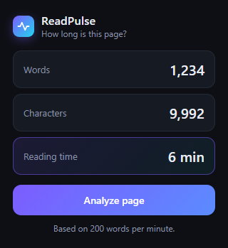
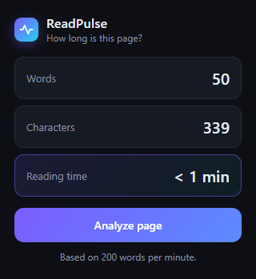
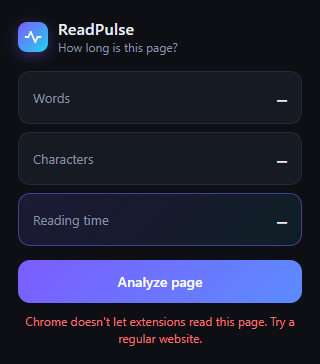

<p align="center">
  
</p>

<h1 align="center">ReadPulse</h1>

<p align="center">
  <strong>How long is this page?</strong><br>
  A tiny, private Chrome extension that shows the word count, character count and estimated reading time of any web page in one click.
</p>

<p align="center">
  <a href="https://github.com/kaysodesu/ReadPulse/releases/latest"><strong>⬇ Download the latest release</strong></a>
</p>

<p align="center">
  
</p>

---

## Contents

- [Features](#features)
- [Install](#install)
- [How to use](#how-to-use)
- [How it works](#how-it-works)
- [Where it can't run](#where-it-cant-run)
- [Privacy and permissions](#privacy-and-permissions)
- [Project structure](#project-structure)
- [Customizing](#customizing)
- [Troubleshooting](#troubleshooting)
- [Updating](#updating)
- [Uninstalling](#uninstalling)
- [License](#license)

## Features

- **Word count**: every word of visible text on the page, formatted with thousands separators (for example `12,480`).
- **Character count**: total visible characters, including spaces and punctuation.
- **Reading time**: an estimate at **200 words per minute**, rounded to the nearest minute. Very short pages show `< 1 min`.
- **Sleek dark-mode popup**: a compact 320px card with a loading spinner and clear messages.
- **Friendly errors**: on pages Chrome doesn't let extensions read, you get a plain-English explanation instead of a crash.
- **Private by design**: no tracking, no analytics, no network requests, no data stored. Everything runs locally in your browser.
- **Lightweight**: three small files, no frameworks, no build step, no remote code.

## Install

ReadPulse isn't on the Chrome Web Store, so you install it as an "unpacked" extension. It takes about a minute.

### 1. Download

**Option A: release ZIP (easiest)**

1. Go to the [latest release](https://github.com/kaysodesu/ReadPulse/releases/latest).
2. Under **Assets**, download `ReadPulse-v1.0.0.zip`.
3. Right-click the ZIP and choose **Extract All…**. Put the extracted folder somewhere permanent, such as your Documents folder. Chrome loads the extension from this folder, so don't delete or move it later.

**Option B: clone with Git**

```bash
git clone https://github.com/kaysodesu/ReadPulse.git
```

### 2. Load it into Chrome

1. Open Chrome and type `chrome://extensions` in the address bar, then press Enter.
2. Turn on **Developer mode** with the switch in the top-right corner.
3. Click **Load unpacked**.
4. Select the `ReadPulse` folder, the one that directly contains `manifest.json`.
5. ReadPulse now appears in your list of extensions.

### 3. Pin it to the toolbar

1. Click the **puzzle-piece icon** (Extensions) to the right of the address bar.
2. Click the **pin** next to ReadPulse so its icon stays visible.

> **Works in other Chromium browsers too.** Microsoft Edge (`edge://extensions`), Brave (`brave://extensions`), Opera and Vivaldi all support loading unpacked extensions in the same way.

## How to use

1. Open any article, blog post, documentation page or other website.
2. Click the **ReadPulse** icon in your toolbar.
3. Click **Analyze page**.
4. The popup shows:

| Stat | What it means |
|---|---|
| **Words** | Number of words in the page's visible text |
| **Characters** | Number of visible characters, including spaces |
| **Reading time** | Words ÷ 200, rounded to the nearest minute (`< 1 min` for under 200 words) |

Switch to another tab? Just click the icon and **Analyze page** again. ReadPulse always reads the tab you're currently looking at.

<p align="center">
  
  &nbsp;&nbsp;
  
</p>

## How it works

When you click **Analyze page**, the popup:

1. Finds the active tab with `chrome.tabs.query`.
2. Runs a one-line function in that tab with `chrome.scripting.executeScript`, which returns `document.body.innerText`: the text you can actually see, without HTML tags, scripts or hidden elements.
3. Counts words by splitting the text on any whitespace (spaces, tabs, line breaks) and ignoring empty pieces.
4. Counts characters with the length of that text.
5. Divides the word count by 200 to estimate reading time.
6. Formats the numbers for your locale and shows them in the popup.

Nothing is saved, and the page text never leaves your computer.

### Good to know about the numbers

- Text inside menus, footers, sidebars and cookie banners counts too, because it's part of the visible page. On long articles this barely changes the reading time.
- Content inside `<iframe>` embeds (such as some comment sections or embedded posts) isn't included.
- Pages that load more content as you scroll ("infinite scroll") only count what has loaded so far. Scroll down and analyze again for a bigger number.
- Languages written without spaces between words (such as Chinese, Japanese and Thai) will show a lower word count. The character count is still accurate.

## Where it can't run

For security, Chrome blocks every extension from reading certain pages. ReadPulse shows a red message on these instead of numbers:

| Page | Why |
|---|---|
| `chrome://` pages (Settings, History, Extensions, New Tab) | Chrome's internal pages are off-limits to all extensions |
| Chrome Web Store | Protected by Chrome |
| Other extensions' pages (`chrome-extension://`) | Each extension is isolated |
| `view-source:` and DevTools pages | Not regular web pages |
| Local files (`file://`) | Blocked unless you allow it (see below) |

**PDFs** opened in Chrome's built-in viewer aren't blocked, but their text lives inside Chrome's protected PDF viewer. ReadPulse sees an empty page there and shows "No readable text found on this page."

**To analyze local HTML or text files:** go to `chrome://extensions`, click **Details** on ReadPulse, and turn on **Allow access to file URLs**.

## Privacy and permissions

ReadPulse asks for only two permissions:

| Permission | Why it's needed |
|---|---|
| `activeTab` | Gives temporary access to **only the tab you're on**, and **only after you click** the ReadPulse icon. It can't see your other tabs or browse in the background. |
| `scripting` | Lets it run the one-line function that reads the page's visible text. |

ReadPulse does **not**:

- send any data anywhere (it makes no network requests at all),
- store your browsing history or page content,
- use analytics, cookies or trackers,
- load any code from the internet.

You can check this yourself: all of the logic is in one short file, [`popup.js`](popup.js), and the layout is in [`popup.html`](popup.html).

## Project structure

```
ReadPulse/
├── manifest.json     Extension settings (Manifest V3), permissions and icons
├── popup.html        The popup's layout and dark-mode styles (no external CSS)
├── popup.js          Reads the page text, counts words/characters, shows results
├── icons/
│   ├── icon16.png    Toolbar icon
│   ├── icon48.png    Extensions page icon
│   └── icon128.png   Install / details icon
├── docs/             Screenshots used in this README
├── LICENSE           MIT License
└── README.md         You're reading it
```

Built with plain HTML, CSS and JavaScript using Chrome's **Manifest V3** extension platform. All styles are written inline because Manifest V3 blocks scripts loaded from the internet, which rules out CDN frameworks such as Tailwind's.

## Customizing

All changes are a quick edit away. After editing, go to `chrome://extensions` and click the **↻ reload** icon on the ReadPulse card.

- **Reading speed:** in `popup.js`, change `const WORDS_PER_MINUTE = 200;`. For example, `250` for fast readers or `150` for technical material.
- **Colors:** in `popup.html`, edit the variables at the top of the `<style>` block (`--bg`, `--card`, `--accent`, `--accent-2` and so on).
- **Popup width:** in `popup.html`, change `width: 320px;` on `body`.

## Troubleshooting

**"Load unpacked" is missing.**
Turn on **Developer mode** in the top-right corner of `chrome://extensions`.

**Chrome says "Manifest file is missing or unreadable."**
You picked the wrong folder. Choose the folder that directly contains `manifest.json`. After extracting the ZIP, this is sometimes a folder *inside* another folder with the same name.

**"Couldn't read this page. Try reloading it and analyzing again."**
The page may still be loading or was opened before ReadPulse was installed. Refresh the page (F5) and click **Analyze page** again.

**The numbers seem high.**
Navigation menus, footers and sidebars count as visible text. See [Good to know about the numbers](#good-to-know-about-the-numbers).

**Chrome shows a "Disable developer mode extensions" warning on startup.**
This is normal for any unpacked extension. Click the **×** to dismiss it. Don't click "Disable" unless you want to turn ReadPulse off.

**The extension disappeared or shows an error after moving files.**
Chrome loads ReadPulse from the folder you selected. If you moved or deleted it, remove ReadPulse from `chrome://extensions` and load it again from its new location.

## Updating

1. Download the newest release ZIP (or run `git pull` if you cloned it).
2. Replace the files in your existing ReadPulse folder with the new ones.
3. Go to `chrome://extensions` and click **↻ reload** on the ReadPulse card.

## Uninstalling

Go to `chrome://extensions`, find ReadPulse and click **Remove**. You can then delete the folder.

## License

[MIT](LICENSE). Free to use, modify and share.
